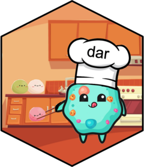

<!-- README.md is generated from README.Rmd. Please edit that file -->

```{r readme-setup, include = FALSE}
knitr::opts_chunk$set(
  collapse = TRUE,
  comment = "#>",
  results = "hide",
  message = FALSE,
  fig.path = "man/figures/README-",
  out.width = "100%"
)
```

# dar <a href="https://microbialgenomics-irsicaixaorg.github.io/dar/"></a>

<!-- badges: start -->
[](https://lifecycle.r-lib.org/articles/stages.html#experimental)
[](https://github.com/MicrobialGenomics-IrsicaixaOrg/dar/actions)
[](https://app.codecov.io/gh/MicrobialGenomics-IrsicaixaOrg/dar?branch=devel)
[](https://makeapullrequest.com)
[](https://github.com/MicrobialGenomics-IrsicaixaOrg/dar/issues)
[](https://github.com/MicrobialGenomics-IrsicaixaOrg/dar/pulls)
<!-- badges: end -->

## Introduction

`dar` provides recipe-based differential abundance workflows for microbiome
data. It accepts `phyloseq` and `TreeSummarizedExperiment` inputs and combines
preprocessing, quality control and multiple statistical methods through a
common, pipeable interface.

A centralized model defines covariates, contrasts, reference levels and the
taxonomic level of analysis. Compatibility checks identify which methods can
execute that design. Results can be inspected, visualized and compared in a
common format while retaining method-specific effect scales. Native options
remain explicit, and recipes can be shared through a versioned, non-executable
export format.

Consensus is optional: it summarizes agreement across methods for the same
contrast and effect direction. Agreement does not guarantee greater accuracy
or false-discovery-rate control, and stricter rules can reduce sensitivity.

## Installation

You can install the development version of dar from [GitHub](https://github.com/) with:

```{r install, eval=FALSE}
# install.packages("pak")
pak::pkg_install("MicrobialGenomics-IrsicaixaOrg/dar")
```

## Usage 

```{r usage}
library(dar)
data("metaHIV_phy")

## Define recipe
rec <-
  recipe(metaHIV_phy) |>
  add_model(
    ~ RiskGroup2,
    targets = "RiskGroup2",
    tax_level = "Species"
  ) |>
  step_subset_taxa(tax_level = "Kingdom", taxa = c("Bacteria", "Archaea")) |>
  step_filter_taxa(.f = "function(x) sum(x > 0) >= (0.03 * length(x))") |>
  step_maaslin() |>
  step_aldex()

rec

## Prep recipe
da_results <- prep(rec, parallel = TRUE)
da_results

## Inspect per-method results in a common format
tidy_results(da_results) |>
  dplyr::select(
    taxa_id, comparison, effect_size, effect_metric,
    adj_p_value, significant, method, step_id
  )
```

The `effect_metric` column identifies each method's effect scale; effect sizes
from different methods are not necessarily directly comparable. The per-method
results can be used without applying a consensus rule.

### Optional consensus summary

To add an agreement-based summary, specify the number of supporting methods
with `bake()` and extract the selected taxa with `cool()`:

```{r optional-consensus}
n_methods <- 2
da_results <- bake(da_results, count_cutoff = n_methods)
da_results

## Results
cool(da_results)
```

## Contributing

- If you think you have encountered a bug, please [submit an issue](https://github.com/MicrobialGenomics-IrsicaixaOrg/dar/issues).

- Either way, learn how to create and share a [reprex](https://reprex.tidyverse.org/articles/articles/learn-reprex.html) (a minimal, reproducible example), to clearly communicate about your code.

- Working on your first Pull Request? You can learn how from this *free* series [How to Contribute to an Open Source Project on GitHub](https://kcd.im/pull-request)

## Code of Conduct

Please note that the dar project is released with a [Contributor Code of Conduct](https://contributor-covenant.org/version/2/0/CODE_OF_CONDUCT.html). By contributing to this project, you agree to abide by its terms.
