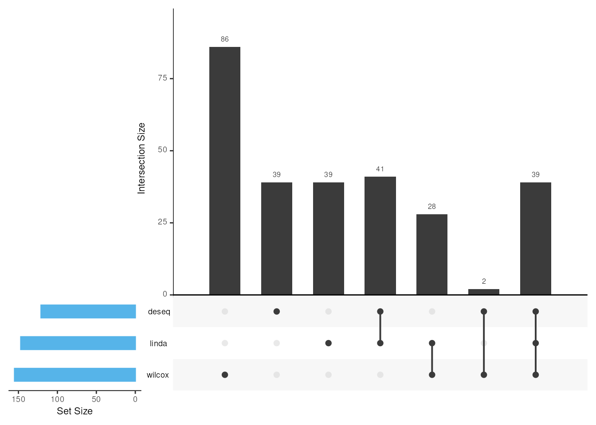
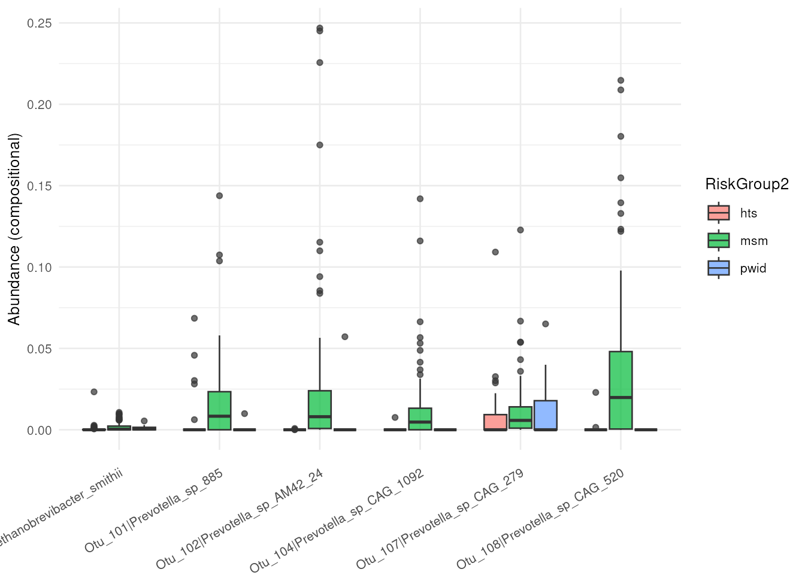

# Exploring results and optional consensus

This guide starts from individual method results. Agreement summaries
and consensus rules are optional: neither replaces the methods’
assumptions or establishes a calibrated false-discovery rate.

## Prepare a small multi-method workflow

The included real dataset makes this guide self-contained. Its
unadjusted `RiskGroup2` comparison illustrates associations, not causal
effects or validated biomarkers. DESeq2, LinDA and Wilcoxon can all
execute this simple design; Wilcoxon cannot adjust for additional
covariates. For other designs, consult [Statistical models and
contrasts](https://microbialgenomics-irsicaixaorg.github.io/dar/articles/statistical_models.md).

For illustration, fix an optional agreement rule of two supporting
methods out of three before examining discoveries. This is not an
optimized or generally recommended rule.

\
[`data`](https://rdrr.io/r/utils/data.html)`(``"metaHIV_phy"``, package ``=`` ``"dar"``)`\
`agreement_cutoff`` ``<-`` ``2`\
\
`rec`` ``<-`` `[`recipe`](https://microbialgenomics-irsicaixaorg.github.io/dar/reference/recipe.md)`(``metaHIV_phy``)`` ``|>`\
`  `[`add_model`](https://microbialgenomics-irsicaixaorg.github.io/dar/reference/add_model.md)`(`\
`    ``~`` ``RiskGroup2``,`\
`    targets ``=`` ``"RiskGroup2"``,`\
`    tax_level ``=`` ``"Species"``,`\
`    reference ``=`` `[`c`](https://rdrr.io/r/base/c.html)`(``RiskGroup2 ``=`` ``"hts"``)`\
`  ``)`` ``|>`\
`  `[`step_subset_taxa`](https://microbialgenomics-irsicaixaorg.github.io/dar/reference/step_subset_taxa.md)`(``tax_level ``=`` ``"Kingdom"``, taxa ``=`` `[`c`](https://rdrr.io/r/base/c.html)`(``"Bacteria"``, ``"Archaea"``)``)`` ``|>`\
`  `[`step_filter_by_prevalence`](https://microbialgenomics-irsicaixaorg.github.io/dar/reference/step_filter_by_prevalence.md)`(``threshold ``=`` ``0.03``)`` ``|>`\
`  `[`step_deseq`](https://microbialgenomics-irsicaixaorg.github.io/dar/reference/step_deseq.md)`(``id ``=`` ``"deseq"``)`` ``|>`\
`  `[`step_linda`](https://microbialgenomics-irsicaixaorg.github.io/dar/reference/step_linda.md)`(``id ``=`` ``"linda"``)`` ``|>`\
`  `[`step_wilcox`](https://microbialgenomics-irsicaixaorg.github.io/dar/reference/step_wilcox.md)`(``id ``=`` ``"wilcox"``)`\
`#> Registered S3 method overwritten by 'car':`\
`#>   method           from`\
`#>   na.action.merMod lme4`\
\
`fit`` ``<-`` `[`prep`](https://microbialgenomics-irsicaixaorg.github.io/dar/reference/prep.md)`(``rec``, parallel ``=`` ``FALSE``)`\
`#> You have inserted a phyloseq object. The phyloseq-based methods will be deprecated. We recommend switching to the (Tree)SummarizedExperiment framework and mia R/Bioconductor package.`

## Inspect the result table

[`tidy_results()`](https://microbialgenomics-irsicaixaorg.github.io/dar/reference/tidy_results.md)
exposes one row per returned taxon, contrast and configured step,
without replacing the native tables held in the prepared recipe.

\
`results`` ``<-`` `[`tidy_results`](https://microbialgenomics-irsicaixaorg.github.io/dar/reference/tidy_results.md)`(``fit``)`\
`results`` ``|>`\
`  ``dplyr``::`[`select`](https://dplyr.tidyverse.org/reference/select.html)`(`\
`    ``taxa_id``, ``contrast_id``, ``numerator``, ``denominator``,`\
`    ``effect_size``, ``effect_metric``, ``adj_p_value``, ``significant``, ``method``, ``step_id`\
`  ``)`` ``|>`\
`  `[`head`](https://rdrr.io/r/utils/head.html)`(``)`\
`#> ``# A tibble: 6 × 10`\
`#>   taxa_id contrast_id         numerator denominator effect_size effect_metric   `\
`#>   ``<chr>``   ``<chr>``               ``<chr>``     ``<chr>``             ``<dbl>`` ``<chr>``           `\
`#> ``1`` Otu_1   RiskGroup2[msm-hts] msm       hts               0.640 log2_fold_change`\
`#> ``2`` Otu_2   RiskGroup2[msm-hts] msm       hts               1.58  log2_fold_change`\
`#> ``3`` Otu_7   RiskGroup2[msm-hts] msm       hts               1.28  log2_fold_change`\
`#> ``4`` Otu_10  RiskGroup2[msm-hts] msm       hts               1.39  log2_fold_change`\
`#> ``5`` Otu_11  RiskGroup2[msm-hts] msm       hts              23.3   log2_fold_change`\
`#> ``6`` Otu_12  RiskGroup2[msm-hts] msm       hts               2.23  log2_fold_change`\
`#> ``# ℹ 4 more variables: adj_p_value <dbl>, significant <lgl>, method <chr>,`\
`#> ``#   step_id <chr>`\
\
`results`` ``|>`\
`  ``dplyr``::`[`group_by`](https://dplyr.tidyverse.org/reference/group_by.html)`(``step_id``, ``contrast_id``)`` ``|>`\
`  ``dplyr``::`[`summarise`](https://dplyr.tidyverse.org/reference/summarise.html)`(`\
`    n_returned ``=`` ``dplyr``::`[`n`](https://dplyr.tidyverse.org/reference/context.html)`(``)``,`\
`    n_finite_effects ``=`` `[`sum`](https://rdrr.io/r/base/sum.html)`(`[`is.finite`](https://rdrr.io/r/base/is.finite.html)`(``effect_size``)``)``,`\
`    n_significant ``=`` `[`sum`](https://rdrr.io/r/base/sum.html)`(``significant``, na.rm ``=`` ``TRUE``)``,`\
`    .groups ``=`` ``"drop"`\
`  ``)`\
`#> ``# A tibble: 9 × 5`\
`#>   step_id contrast_id          n_returned n_finite_effects n_significant`\
`#>   ``<chr>``   ``<chr>``                     ``<int>``            ``<int>``         ``<int>`\
`#> ``1`` deseq   RiskGroup2[msm-hts]         278              278           121`\
`#> ``2`` deseq   RiskGroup2[pwid-hts]        278              278            63`\
`#> ``3`` deseq   RiskGroup2[pwid-msm]        278              278           108`\
`#> ``4`` linda   RiskGroup2[msm-hts]         278              278           147`\
`#> ``5`` linda   RiskGroup2[pwid-hts]        278              278             0`\
`#> ``6`` linda   RiskGroup2[pwid-msm]        278              278            98`\
`#> ``7`` wilcox  RiskGroup2[msm-hts]         278              278           155`\
`#> ``8`` wilcox  RiskGroup2[pwid-hts]        278              278             0`\
`#> ``9`` wilcox  RiskGroup2[pwid-msm]        278              278           106`

Use `effect_metric` to interpret effect sizes. A log2 fold change and a
difference in median relative abundance are not numerically
interchangeable. The numerator and denominator define the orientation of
each contrast. `significant` retains the configured method’s decision,
which can include criteria beyond an adjusted p-value, such as
ANCOM-BC2’s sensitivity filter. Missing statistics remain missing; a
non-significant result alone does not prove that every native estimate
was available or that there is no effect.

`method` names the stable engine; `step_id` identifies its
configuration. For example, select two executed steps without rerunning
them:

\
[`tidy_results`](https://microbialgenomics-irsicaixaorg.github.io/dar/reference/tidy_results.md)`(``fit``, steps ``=`` `[`c`](https://rdrr.io/r/base/c.html)`(``"deseq"``, ``"linda"``)``, significant_only ``=`` ``TRUE``)`` ``|>`\
`  `[`head`](https://rdrr.io/r/utils/head.html)`(``)`\
`#> ``# A tibble: 6 × 17`\
`#>   taxa_id taxa  contrast_id comparison contrast_type var   numerator denominator`\
`#>   ``<chr>``   ``<chr>`` ``<chr>``       ``<chr>``      ``<chr>``         ``<chr>`` ``<chr>``     ``<chr>``      `\
`#> ``1`` Otu_11  Bifi… RiskGroup2… RiskGroup… main          Risk… msm       hts        `\
`#> ``2`` Otu_15  Bifi… RiskGroup2… RiskGroup… main          Risk… msm       hts        `\
`#> ``3`` Otu_19  Bifi… RiskGroup2… RiskGroup… main          Risk… msm       hts        `\
`#> ``4`` Otu_34  Olse… RiskGroup2… RiskGroup… main          Risk… msm       hts        `\
`#> ``5`` Otu_35  Coll… RiskGroup2… RiskGroup… main          Risk… msm       hts        `\
`#> ``6`` Otu_37  Coll… RiskGroup2… RiskGroup… main          Risk… msm       hts        `\
`#> ``# ℹ 9 more variables: at_var <chr>, at_level <chr>, effect_size <dbl>,`\
`#> ``#   effect_metric <chr>, p_value <dbl>, adj_p_value <dbl>, significant <lgl>,`\
`#> ``#   method <chr>, step_id <chr>`

Custom DA step IDs must not collide with internal columns such as
`effect`, `taxa_id` or `sum`; use a distinct name such as
`linda_sensitivity`.

## Select a contrast explicitly

\
`results`` ``|>`\
`  ``dplyr``::`[`distinct`](https://dplyr.tidyverse.org/reference/distinct.html)`(``contrast_id``, ``comparison``, ``numerator``, ``denominator``)`\
`#> ``# A tibble: 3 × 4`\
`#>   contrast_id          comparison           numerator denominator`\
`#>   ``<chr>``                ``<chr>``                ``<chr>``     ``<chr>``      `\
`#> ``1`` RiskGroup2[msm-hts]  RiskGroup2[msm-hts]  msm       hts        `\
`#> ``2`` RiskGroup2[pwid-hts] RiskGroup2[pwid-hts] pwid      hts        `\
`#> ``3`` RiskGroup2[pwid-msm] RiskGroup2[pwid-msm] pwid      msm`\
\
`comparison_id`` ``<-`` ``"RiskGroup2[msm-hts]"`\
`selected_results`` ``<-`` ``results`` ``|>`\
`  ``dplyr``::`[`filter`](https://dplyr.tidyverse.org/reference/filter.html)`(``contrast_id`` ``==`` ``comparison_id``)`

For longitudinal designs, `contrast_id` also distinguishes comparisons
within visits and difference-in-differences. These hypotheses must not
be pooled.

## Visualize discoveries and agreement

Select taxon IDs from the results you intend to plot. Here the selection
is the union of discoveries for one contrast, not a consensus.
[`abundance_plt()`](https://microbialgenomics-irsicaixaorg.github.io/dar/reference/abundance_plt.md)
uses the same aggregated taxonomic analysis view as the modeled methods.

\
`taxa_ids`` ``<-`` ``selected_results`` ``|>`\
`  ``dplyr``::`[`filter`](https://dplyr.tidyverse.org/reference/filter.html)`(``significant``)`` ``|>`\
`  ``dplyr``::`[`distinct`](https://dplyr.tidyverse.org/reference/distinct.html)`(``taxa_id``)`` ``|>`\
`  ``dplyr``::`[`pull`](https://dplyr.tidyverse.org/reference/pull.html)`(``taxa_id``)`` ``|>`\
`  `[`head`](https://rdrr.io/r/utils/head.html)`(``6``)`\
\
`if`` ``(`[`length`](https://rdrr.io/r/base/length.html)`(``taxa_ids``)``)`` ``{`\
`  `[`abundance_plt`](https://microbialgenomics-irsicaixaorg.github.io/dar/reference/abundance_plt.md)`(`\
`    ``fit``, taxa_ids ``=`` ``taxa_ids``,`\
`    contrast_id ``=`` ``comparison_id``, type ``=`` ``"boxplot"`\
`  ``)`\
`}`` ``else`` ``{`\
`  `[`message`](https://rdrr.io/r/base/message.html)`(``"No significant taxa for this comparison."``)`\
`}`


[`intersection_plt()`](https://microbialgenomics-irsicaixaorg.github.io/dar/reference/intersection_plt.md)
displays overlaps of discoveries, respecting contrast and effect
direction. Overlap is descriptive evidence of agreement, not independent
validation of a taxon or a measure of statistical accuracy.

\
[`intersection_plt`](https://microbialgenomics-irsicaixaorg.github.io/dar/reference/intersection_plt.md)`(``fit``, contrast_id ``=`` ``comparison_id``, font_size ``=`` ``1``)`\
`` #> Warning: `aes_string()` was deprecated in ggplot2 3.0.0. ``\
`#> ``ℹ```  Please use tidy evaluation idioms with `aes()`. ``\
`#> ``ℹ```  See also `vignette("ggplot2-in-packages")` for more information. ``\
`#> ``ℹ`` The deprecated feature was likely used in the ``UpSetR`` package.`\
`#>   Please report the issue at ``<https://github.com/hms-dbmi/UpSetR/issues>``.`\
`#> ``This warning is displayed once per session.`\
`#> ``` Call `lifecycle::last_lifecycle_warnings()` to see where this warning was ``\
`#> ``generated.`\
`` #> Warning: Using `size` aesthetic for lines was deprecated in ggplot2 3.4.0. ``\
`#> ``ℹ```  Please use `linewidth` instead. ``\
`#> ``ℹ`` The deprecated feature was likely used in the ``UpSetR`` package.`\
`#>   Please report the issue at ``<https://github.com/hms-dbmi/UpSetR/issues>``.`\
`#> ``This warning is displayed once per session.`\
`#> ``` Call `lifecycle::last_lifecycle_warnings()` to see where this warning was ``\
`#> ``generated.`\
`` #> Warning: The `size` argument of `element_line()` is deprecated as of ggplot2 3.4.0. ``\
`#> ``ℹ```  Please use the `linewidth` argument instead. ``\
`#> ``ℹ`` The deprecated feature was likely used in the ``UpSetR`` package.`\
`#>   Please report the issue at ``<https://github.com/hms-dbmi/UpSetR/issues>``.`\
`#> ``This warning is displayed once per session.`\
`#> ``` Call `lifecycle::last_lifecycle_warnings()` to see where this warning was ``\
`#> ``generated.`



Despite its name,
[`corr_heatmap()`](https://microbialgenomics-irsicaixaorg.github.io/dar/reference/corr_heatmap.md)
does not correlate taxon abundances. With `type = "all"`, it summarizes
agreement in binary method decisions, including shared non-detections. A
high value therefore need not mean many shared discoveries.
`type = "da"` restricts the comparison to hypotheses detected by at
least one method and requires a non-empty set.

\
[`corr_heatmap`](https://microbialgenomics-irsicaixaorg.github.io/dar/reference/corr_heatmap.md)`(``fit``, type ``=`` ``"all"``, contrast_id ``=`` ``comparison_id``, font_size ``=`` ``9``)`\
`#> Registered S3 method overwritten by 'dendextend':`\
`#>   method     from `\
`#>   rev.hclust vegan`\
`#> Registered S3 method overwritten by 'httr':`\
`#>   method         from  `\
`#>   print.response rmutil`\
`#> Registered S3 method overwritten by 'seriation':`\
`#>   method         from `\
`#>   reorder.hclust vegan`

[`exclusion_plt()`](https://microbialgenomics-irsicaixaorg.github.io/dar/reference/exclusion_plt.md)
and
[`mutual_plt()`](https://microbialgenomics-irsicaixaorg.github.io/dar/reference/mutual_plt.md)
provide alternative summaries of unique and shared detections. Automatic
discovery plots report when no significant taxa are available. Some
automatic selections fall back to the largest observed overlap when no
taxon reaches the requested support. To plot exactly a specified
selection, provide explicit `taxa_ids` as above rather than relying on
that fallback.

## Optional consensus rules

For confirmatory work, specify the panel, cutoff and any weights before
inspecting discoveries. More agreement does not guarantee greater
accuracy or false-discovery-rate control. Strict rules can discard true
signals when components have low sensitivity or make correlated errors.

[`bake()`](https://microbialgenomics-irsicaixaorg.github.io/dar/reference/bake.md)
records a rule;
[`cool()`](https://microbialgenomics-irsicaixaorg.github.io/dar/reference/cool.md)
applies it without fitting the methods again. Votes are counted
separately for each contrast and effect direction.

\
`with_agreement`` ``<-`` `[`bake`](https://microbialgenomics-irsicaixaorg.github.io/dar/reference/bake.md)`(`\
`  ``fit``, count_cutoff ``=`` ``agreement_cutoff``, id ``=`` ``"two_of_three"`\
`)`\
`agreement`` ``<-`` `[`cool`](https://microbialgenomics-irsicaixaorg.github.io/dar/reference/cool.md)`(``with_agreement``, bake ``=`` ``"two_of_three"``)`\
`#> ``ℹ`` Baking with ``count_cutoff =`` ``2`\
[`head`](https://rdrr.io/r/utils/head.html)`(``agreement``)`\
`#> ``# A tibble: 6 × 9`\
`#>   taxa_id taxa    contrast_id comparison contrast_type var   effect method_count`\
`#>   ``<chr>``   ``<chr>``   ``<chr>``       ``<chr>``      ``<chr>``         ``<chr>`` ``<chr>``         ``<dbl>`\
`#> ``1`` Otu_1   Methan… RiskGroup2… RiskGroup… main          Risk… up                2`\
`#> ``2`` Otu_101 Prevot… RiskGroup2… RiskGroup… main          Risk… up                2`\
`#> ``3`` Otu_101 Prevot… RiskGroup2… RiskGroup… main          Risk… down              3`\
`#> ``4`` Otu_102 Prevot… RiskGroup2… RiskGroup… main          Risk… up                3`\
`#> ``5`` Otu_102 Prevot… RiskGroup2… RiskGroup… main          Risk… down              3`\
`#> ``6`` Otu_104 Prevot… RiskGroup2… RiskGroup… main          Risk… up                3`\
`#> ``# ℹ 1 more variable: methods <chr>`

With unit weights, the cutoff is the number of supporting steps. A taxon
that is selected with conflicting directions does not combine those
votes. The result retains the contrast, direction, support and
contributing step IDs.

To plot only this rule’s selected taxa for the chosen contrast:

\
`agreement_ids`` ``<-`` ``agreement`` ``|>`\
`  ``dplyr``::`[`filter`](https://dplyr.tidyverse.org/reference/filter.html)`(``contrast_id`` ``==`` ``comparison_id``)`` ``|>`\
`  ``dplyr``::`[`distinct`](https://dplyr.tidyverse.org/reference/distinct.html)`(``taxa_id``)`` ``|>`\
`  ``dplyr``::`[`pull`](https://dplyr.tidyverse.org/reference/pull.html)`(``taxa_id``)`` ``|>`\
`  `[`head`](https://rdrr.io/r/utils/head.html)`(``6``)`\
\
`if`` ``(`[`length`](https://rdrr.io/r/base/length.html)`(``agreement_ids``)``)`` ``{`\
`  `[`abundance_plt`](https://microbialgenomics-irsicaixaorg.github.io/dar/reference/abundance_plt.md)`(`\
`    ``with_agreement``, taxa_ids ``=`` ``agreement_ids``,`\
`    contrast_id ``=`` ``comparison_id``, type ``=`` ``"boxplot"`\
`  ``)`\
`}`` ``else`` ``{`\
`  `[`message`](https://rdrr.io/r/base/message.html)`(``"No taxa satisfy the specified agreement rule for this comparison."``)`\
`}`



An empty consensus is valid and is not a reason to change the rule
retrospectively. Per-method results remain available in `fit`.

### Exclusions and weights

These are configuration examples, not alternative rules selected for
their discoveries. `exclude` uses executed step IDs. Named weights must
exactly match the non-excluded steps; when using weights, set the cutoff
explicitly because the default is the number of retained steps, not the
sum of weights.

\
[`bake`](https://microbialgenomics-irsicaixaorg.github.io/dar/reference/bake.md)`(``fit``, exclude ``=`` ``"wilcox"``, count_cutoff ``=`` ``2``, id ``=`` ``"two_retained_steps"``)`\
[`bake`](https://microbialgenomics-irsicaixaorg.github.io/dar/reference/bake.md)`(`\
`  ``fit``,`\
`  weights ``=`` `[`c`](https://rdrr.io/r/base/c.html)`(``deseq ``=`` ``1``, linda ``=`` ``2``, wilcox ``=`` ``1``)``,`\
`  count_cutoff ``=`` ``3``,`\
`  id ``=`` ``"weighted_support"`\
`)`

Weights express a chosen rule, not estimated probabilities that the
methods are correct. Repeated configurations of one engine are not
independent sources of evidence.

\
[`sessionInfo`](https://rdrr.io/r/utils/sessionInfo.html)`(``)`\
`#> R version 4.6.1 (2026-06-24)`\
`#> Platform: x86_64-pc-linux-gnu`\
`#> Running under: Ubuntu 24.04.4 LTS`\
`#> `\
`#> Matrix products: default`\
`#> BLAS:   /usr/lib/x86_64-linux-gnu/openblas-pthread/libblas.so.3 `\
`#> LAPACK: /usr/lib/x86_64-linux-gnu/openblas-pthread/libopenblasp-r0.3.26.so;  LAPACK version 3.12.0`\
`#> `\
`#> locale:`\
`#>  [1] LC_CTYPE=en_US.UTF-8       LC_NUMERIC=C              `\
`#>  [3] LC_TIME=en_US.UTF-8        LC_COLLATE=en_US.UTF-8    `\
`#>  [5] LC_MONETARY=en_US.UTF-8    LC_MESSAGES=en_US.UTF-8   `\
`#>  [7] LC_PAPER=en_US.UTF-8       LC_NAME=C                 `\
`#>  [9] LC_ADDRESS=C               LC_TELEPHONE=C            `\
`#> [11] LC_MEASUREMENT=en_US.UTF-8 LC_IDENTIFICATION=C       `\
`#> `\
`#> time zone: UTC`\
`#> tzcode source: system (glibc)`\
`#> `\
`#> attached base packages:`\
`#> [1] stats     graphics  grDevices utils     datasets  methods   base     `\
`#> `\
`#> other attached packages:`\
`#> [1] dar_1.9.12`\
`#> `\
`#> loaded via a namespace (and not attached):`\
`#>   [1] fs_2.1.0                        matrixStats_1.5.0              `\
`#>   [3] DirichletMultinomial_1.55.1     httr_1.4.9                     `\
`#>   [5] webshot_0.5.5                   RColorBrewer_1.1-3             `\
`#>   [7] numDeriv_2016.8-1.1             tools_4.6.1                    `\
`#>   [9] backports_1.5.1                 utf8_1.2.6                     `\
`#>  [11] R6_2.6.1                        vegan_2.7-6                    `\
`#>  [13] lazyeval_0.2.3                  mgcv_1.9-4                     `\
`#>  [15] apeglm_1.35.0                   permute_0.9-10                 `\
`#>  [17] withr_3.0.3                     gridExtra_2.3.1                `\
`#>  [19] cli_3.6.6                       Biobase_2.73.2                 `\
`#>  [21] textshaping_1.0.5               TSP_1.2.7                      `\
`#>  [23] labeling_0.4.3                  sass_0.4.10                    `\
`#>  [25] SQUAREM_2026.1                  mvtnorm_1.4-2                  `\
`#>  [27] S7_0.2.2                        pkgdown_2.2.1                  `\
`#>  [29] mixsqp_0.3-54                   mlr3tuning_1.7.0               `\
`#>  [31] systemfonts_1.3.2               yulab.utils_0.2.5              `\
`#>  [33] paradox_1.0.1                   scater_1.41.2                  `\
`#>  [35] decontam_1.33.0                 parallelly_1.48.0              `\
`#>  [37] invgamma_1.2                    bbmle_1.0.26                   `\
`#>  [39] generics_0.1.4                  crosstalk_1.2.2                `\
`#>  [41] car_3.1-5                       dplyr_1.2.1                    `\
`#>  [43] dendextend_1.19.1               Matrix_1.7-6                   `\
`#>  [45] biomformat_1.41.0               ggbeeswarm_0.7.3               `\
`#>  [47] S4Vectors_0.51.10               DECIPHER_3.9.3                 `\
`#>  [49] abind_1.4-8                     lifecycle_1.0.5                `\
`#>  [51] yaml_2.3.12                     carData_3.0-6                  `\
`#>  [53] SummarizedExperiment_1.43.0     SparseArray_1.13.4             `\
`#>  [55] Rtsne_0.17                      grid_4.6.1                     `\
`#>  [57] crayon_1.5.3                    bdsmatrix_1.3-7                `\
`#>  [59] lattice_0.23-1                  beachmat_2.29.3                `\
`#>  [61] pillar_1.11.1                   knitr_1.52                     `\
`#>  [63] GenomicRanges_1.65.4            statip_0.2.3                   `\
`#>  [65] boot_1.3-32                     codetools_0.2-20               `\
`#>  [67] glue_1.8.1                      spacefillr_0.4.0               `\
`#>  [69] data.table_1.18.6.1             MultiAssayExperiment_1.39.1    `\
`#>  [71] vctrs_0.7.3                     treeio_1.37.1                  `\
`#>  [73] Rdpack_2.6.6                    gtable_0.3.6                   `\
`#>  [75] assertthat_0.2.1                emdbook_1.3.14                 `\
`#>  [77] cachem_1.1.0                    xfun_0.61                      `\
`#>  [79] rbibutils_2.4.1                 S4Arrays_1.13.2                `\
`#>  [81] Seqinfo_1.3.2                   coda_0.19-4.1                  `\
`#>  [83] reformulas_0.4.4                modeest_2.5.0                  `\
`#>  [85] survival_3.8-12                 timeDate_4052.112              `\
`#>  [87] SingleCellExperiment_1.35.2     seriation_1.6.0                `\
`#>  [89] iterators_1.0.14                statmod_1.5.2                  `\
`#>  [91] bluster_1.23.1                  nlme_3.1-171                   `\
`#>  [93] phyloseq_1.57.0                 bbotk_1.13.1                   `\
`#>  [95] UpSetR_1.4.1                    fBasics_4052.98                `\
`#>  [97] bslib_0.12.0                    MicrobiomeStat_1.4             `\
`#>  [99] mlr3_1.8.0                      irlba_2.4.1                    `\
`#> [101] vipor_0.4.7                     otel_0.2.0                     `\
`#> [103] rpart_4.1.27                    mlr3mbo_1.2.1                  `\
`#> [105] moocore_0.3.2                   BiocGenerics_0.59.12           `\
`#> [107] DBI_1.3.0                       ade4_1.7-24                    `\
`#> [109] mlr3misc_0.23.0                 DESeq2_1.53.6                  `\
`#> [111] tidyselect_1.2.1                timeSeries_4052.112            `\
`#> [113] compiler_4.6.1                  microbiome_1.35.1              `\
`#> [115] BiocNeighbors_2.7.3             lgr_0.5.2                      `\
`#> [117] desc_1.4.3                      DelayedArray_0.39.8            `\
`#> [119] plotly_4.12.1                   checkmate_2.3.4                `\
`#> [121] scales_1.4.0                    spatial_7.3-19                 `\
`#> [123] rappdirs_0.3.4                  palmerpenguins_0.1.1           `\
`#> [125] stringr_1.6.0                   digest_0.6.39                  `\
`#> [127] minqa_1.2.8                     rmarkdown_2.32                 `\
`#> [129] ca_0.72                         XVector_0.53.0                 `\
`#> [131] htmltools_0.5.9                 pkgconfig_2.0.3                `\
`#> [133] lme4_2.0-6                      sparseMatrixStats_1.25.0       `\
`#> [135] MatrixGenerics_1.25.0           stabledist_0.7-2               `\
`#> [137] fastmap_1.2.0                   rlang_1.3.0                    `\
`#> [139] htmlwidgets_1.6.4               DelayedMatrixStats_1.35.0      `\
`#> [141] farver_2.1.2                    jquerylib_0.1.4                `\
`#> [143] jsonlite_2.0.0                  BiocParallel_1.47.0            `\
`#> [145] BiocSingular_1.29.2             magrittr_2.0.5                 `\
`#> [147] Formula_1.2-6                   scuttle_1.23.2                 `\
`#> [149] Rcpp_1.1.2                      ape_5.8-1                      `\
`#> [151] viridis_0.6.5                   stringi_1.8.9                  `\
`#> [153] stable_1.1.7                    MASS_7.3-66                    `\
`#> [155] plyr_1.8.9                      parallel_4.6.1                 `\
`#> [157] listenv_1.1.0                   ggrepel_0.9.8                  `\
`#> [159] Biostrings_2.81.9               splines_4.6.1                  `\
`#> [161] multtest_2.69.0                 locfit_1.5-9.12                `\
`#> [163] igraph_2.3.4                    uuid_1.2-2                     `\
`#> [165] reshape2_1.4.5                  stats4_4.6.1                   `\
`#> [167] ScaledMatrix_1.21.0             rmutil_1.1.10                  `\
`#> [169] evaluate_1.0.5                  nloptr_2.2.1                   `\
`#> [171] foreach_1.5.2                   tidyr_1.3.2                    `\
`#> [173] purrr_1.2.2                     future_1.76.0                  `\
`#> [175] heatmaply_1.6.0                 clue_0.3-68                    `\
`#> [177] ggplot2_4.0.3                   ashr_2.2-63                    `\
`#> [179] rsvd_1.0.5                      broom_1.0.13                   `\
`#> [181] tidytree_0.4.8                  rstatix_1.1.0                  `\
`#> [183] viridisLite_0.4.3               ragg_1.5.2                     `\
`#> [185] truncnorm_1.0-9                 tibble_3.3.1                   `\
`#> [187] lmerTest_3.2-1                  beeswarm_0.4.0                 `\
`#> [189] registry_0.5-1                  IRanges_2.47.5                 `\
`#> [191] cluster_2.1.8.3                 TreeSummarizedExperiment_2.21.0`\
`#> [193] globals_0.20.0                  mia_1.21.11`
