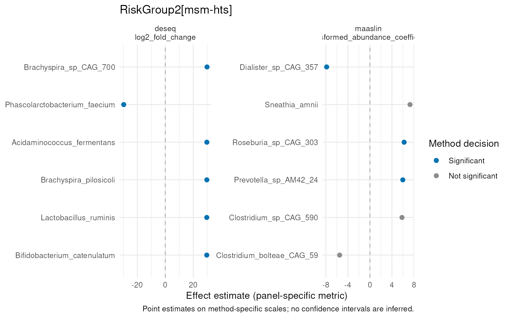
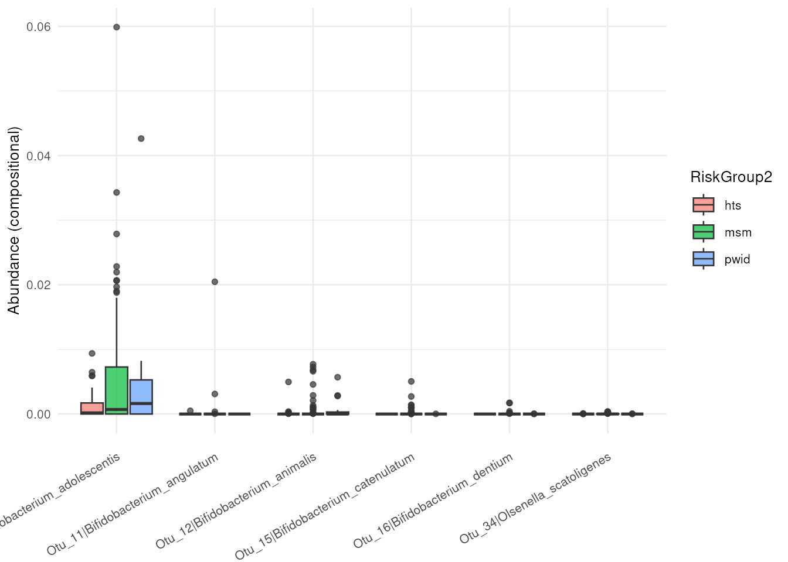

# Getting started with dar

`dar` provides a common interface for configuring, running and comparing
differential abundance methods. A recipe records preprocessing steps, a
shared statistical design and the methods to execute. The prepared
recipe contains per-method results; consensus is an optional summary,
not a required endpoint.

## Example data

The included `metaHIV_phy` object is a `phyloseq` dataset from
[Noguera-Julian et
al. (2016)](https://doi.org/10.1016/j.ebiom.2016.01.032). Here we
compare its recorded `RiskGroup2` categories. This unadjusted example
illustrates the software; it does not establish causal effects or
validated microbial biomarkers. The profiling pipeline and measurement
units of this derived table have not been independently verified, so its
use here is not a recommendation of count-based methods for abundance
profiles of unknown origin.

\
[`data`](https://rdrr.io/r/utils/data.html)`(``"metaHIV_phy"``, package ``=`` ``"dar"``)`\
`metaHIV_phy`\
`#> phyloseq-class experiment-level object`\
`#> otu_table()   OTU Table:         [ 451 taxa and 156 samples ]`\
`#> sample_data() Sample Data:       [ 156 samples by 3 sample variables ]`\
`#> tax_table()   Taxonomy Table:    [ 451 taxa by 7 taxonomic ranks ]`

## Configure a workflow

Create a recipe and define the model once with
[`add_model()`](https://microbialgenomics-irsicaixaorg.github.io/dar/reference/add_model.md).
`targets` selects the variable whose effects are tested; other fixed
terms can adjust for covariates. `tax_level` selects the rank at which
methods analyze the data. An explicit reference makes the direction of
comparisons clear.

\
`rec`` ``<-`` `[`recipe`](https://microbialgenomics-irsicaixaorg.github.io/dar/reference/recipe.md)`(``metaHIV_phy``)`` ``|>`\
`  `[`add_model`](https://microbialgenomics-irsicaixaorg.github.io/dar/reference/add_model.md)`(`\
`    ``~`` ``RiskGroup2``,`\
`    targets ``=`` ``"RiskGroup2"``,`\
`    tax_level ``=`` ``"Species"``,`\
`    reference ``=`` `[`c`](https://rdrr.io/r/base/c.html)`(``RiskGroup2 ``=`` ``"hts"``)`\
`  ``)`` ``|>`\
`  `[`step_subset_taxa`](https://microbialgenomics-irsicaixaorg.github.io/dar/reference/step_subset_taxa.md)`(``tax_level ``=`` ``"Kingdom"``, taxa ``=`` `[`c`](https://rdrr.io/r/base/c.html)`(``"Bacteria"``, ``"Archaea"``)``)`` ``|>`\
`  `[`step_filter_by_prevalence`](https://microbialgenomics-irsicaixaorg.github.io/dar/reference/step_filter_by_prevalence.md)`(``threshold ``=`` ``0.03``)`` ``|>`\
`  `[`step_deseq`](https://microbialgenomics-irsicaixaorg.github.io/dar/reference/step_deseq.md)`(``id ``=`` ``"deseq"``)`` ``|>`\
`  `[`step_maaslin`](https://microbialgenomics-irsicaixaorg.github.io/dar/reference/step_maaslin.md)`(``min_prevalence ``=`` ``0``, id ``=`` ``"maaslin"``)`\
\
`rec`\
`#> ── ``DAR Recipe`` ──────────────────────────────────────────────────────────────────`\
`#> Inputs:`\
`#> `\
`#>      ``ℹ`` phyloseq object with ``451`` taxa and ``156`` samples `\
`#>      ``ℹ`` variable of interes ``RiskGroup2`` (class: character, levels: hts, msm, pwid) `\
`#>      ``ℹ`` taxonomic level ``Species`` `\
`#> `\
`#> Statistical model:`\
`#> `\
`#>      ``ℹ`` ``~RiskGroup2`` `\
`#> `\
`#> Preprocessing steps:`\
`#> `\
`#>      ``◉`` step_subset_taxa() ``id = subset_taxa__Ensaïmada`` `\
`#>      ``◉`` step_filter_by_prevalence() ``id = filter_by_prevalence__Puff_pastry`` `\
`#> `\
`#> DA steps:`\
`#> `\
`#>      ``◉`` step_deseq() ``id = deseq`` `\
`#>      ``◉`` step_maaslin() ``id = maaslin`

The prevalence step retains taxa present in more than 3% of samples. We
disable MaAsLin3’s additional prevalence filter because the recipe
already defines a shared filter; this does not make the engines’
assumptions or effect scales identical. These two compatible methods
illustrate the interface, not a universally recommended panel.

## Run the recipe

[`prep()`](https://microbialgenomics-irsicaixaorg.github.io/dar/reference/prep.md)
applies preprocessing in order, resolves the shared model and runs
compatible methods. This guide uses sequential execution. For separate
worker processes, use `parallel = TRUE` and choose `workers` for the
available memory.

\
`fit`` ``<-`` `[`prep`](https://microbialgenomics-irsicaixaorg.github.io/dar/reference/prep.md)`(``rec``, parallel ``=`` ``FALSE``)`\
`fit`\
`#> ── ``DAR Results`` ─────────────────────────────────────────────────────────────────`\
`#> Inputs:`\
`#> `\
`#>      ``ℹ`` phyloseq object with ``278`` taxa and ``156`` samples `\
`#>      ``ℹ`` variable of interes ``RiskGroup2`` (class: character, levels: hts, msm, pwid) `\
`#>      ``ℹ`` taxonomic level ``Species`` `\
`#> `\
`#> Results:`\
`#> `\
`#>      ``✔`` deseq ``diff_taxa = 167`` `\
`#>      ``✔`` maaslin ``diff_taxa = 47`` `\
`#> `\
`#>      ``ℹ`` 27 taxon-contrast effects are present in all tested methods`

## Inspect per-method results

[`tidy_results()`](https://microbialgenomics-irsicaixaorg.github.io/dar/reference/tidy_results.md)
returns a common table with taxon IDs, contrasts, effect scales,
statistics and method decisions. `method` identifies the engine and
`step_id` identifies its configured instance. Native effect scales
remain distinct; uniform columns do not imply interchangeable effect
sizes or p-values.

\
`results`` ``<-`` `[`tidy_results`](https://microbialgenomics-irsicaixaorg.github.io/dar/reference/tidy_results.md)`(``fit``)`\
`results`` ``|>`\
`  ``dplyr``::`[`select`](https://dplyr.tidyverse.org/reference/select.html)`(`\
`    ``taxa_id``, ``contrast_id``, ``effect_size``, ``effect_metric``,`\
`    ``adj_p_value``, ``significant``, ``method``, ``step_id`\
`  ``)`` ``|>`\
`  `[`head`](https://rdrr.io/r/utils/head.html)`(``)`\
`#> ``# A tibble: 6 × 8`\
`#>   taxa_id contrast_id   effect_size effect_metric adj_p_value significant method`\
`#>   ``<chr>``   ``<chr>``               ``<dbl>`` ``<chr>``               ``<dbl>`` ``<lgl>``       ``<chr>`` `\
`#> ``1`` Otu_1   RiskGroup2[m…        1.34 log2_fold_ch…    1.36``e``- 1`` FALSE       deseq `\
`#> ``2`` Otu_2   RiskGroup2[m…        2.41 log2_fold_ch…    8.12``e``- 2`` FALSE       deseq `\
`#> ``3`` Otu_7   RiskGroup2[m…        2.29 log2_fold_ch…    1.86``e``- 1`` FALSE       deseq `\
`#> ``4`` Otu_10  RiskGroup2[m…        2.49 log2_fold_ch…    2.56``e``- 3`` TRUE        deseq `\
`#> ``5`` Otu_11  RiskGroup2[m…       25.2  log2_fold_ch…    8.97``e``-14`` TRUE        deseq `\
`#> ``6`` Otu_12  RiskGroup2[m…        3.91 log2_fold_ch…    1.18``e``- 2`` TRUE        deseq `\
`#> ``# ℹ 1 more variable: step_id <chr>`\
\
`results`` ``|>`\
`  ``dplyr``::`[`group_by`](https://dplyr.tidyverse.org/reference/group_by.html)`(``step_id``, ``contrast_id``)`` ``|>`\
`  ``dplyr``::`[`summarise`](https://dplyr.tidyverse.org/reference/summarise.html)`(`\
`    n_returned ``=`` ``dplyr``::`[`n`](https://dplyr.tidyverse.org/reference/context.html)`(``)``,`\
`    n_finite_effects ``=`` `[`sum`](https://rdrr.io/r/base/sum.html)`(`[`is.finite`](https://rdrr.io/r/base/is.finite.html)`(``effect_size``)``)``,`\
`    n_significant ``=`` `[`sum`](https://rdrr.io/r/base/sum.html)`(``significant``, na.rm ``=`` ``TRUE``)``,`\
`    .groups ``=`` ``"drop"`\
`  ``)`\
`#> ``# A tibble: 6 × 5`\
`#>   step_id contrast_id          n_returned n_finite_effects n_significant`\
`#>   ``<chr>``   ``<chr>``                     ``<int>``            ``<int>``         ``<int>`\
`#> ``1`` deseq   RiskGroup2[msm-hts]         278              278           137`\
`#> ``2`` deseq   RiskGroup2[pwid-hts]        278              278            65`\
`#> ``3`` deseq   RiskGroup2[pwid-msm]        278              278           117`\
`#> ``4`` maaslin RiskGroup2[msm-hts]         278              251            39`\
`#> ``5`` maaslin RiskGroup2[pwid-hts]        278              218             5`\
`#> ``6`` maaslin RiskGroup2[pwid-msm]        278              211            21`

These results can be used directly, without
[`bake()`](https://microbialgenomics-irsicaixaorg.github.io/dar/reference/bake.md)
or
[`cool()`](https://microbialgenomics-irsicaixaorg.github.io/dar/reference/cool.md).

[`get_execution()`](https://microbialgenomics-irsicaixaorg.github.io/dar/reference/get_execution.md)
exposes the recorded contrast plan, samples removed by the model’s
missing-value policy, and executed or skipped steps. It does not record
every engine’s internal filtering. Older prepared objects can contain
`NULL` fields because that information was not recorded.

\
`execution`` ``<-`` `[`get_execution`](https://microbialgenomics-irsicaixaorg.github.io/dar/reference/get_execution.md)`(``fit``)`\
`execution``$``contrasts`\
`#> ``# A tibble: 3 × 9`\
`#>   contrast_id        comparison contrast_type var   numerator denominator at_var`\
`#>   ``<glue>``             ``<glue>``     ``<chr>``         ``<chr>`` ``<chr>``     ``<chr>``       ``<chr>`` `\
`#> ``1`` RiskGroup2[msm-ht… RiskGroup… main          Risk… msm       hts         ``NA``    `\
`#> ``2`` RiskGroup2[pwid-h… RiskGroup… main          Risk… pwid      hts         ``NA``    `\
`#> ``3`` RiskGroup2[pwid-m… RiskGroup… main          Risk… pwid      msm         ``NA``    `\
`#> ``# ℹ 2 more variables: at_level <chr>, weights <list>`\
`execution``$``dropped_samples`\
`#> character(0)`\
`execution``$``executed_steps`\
`#> [1] "deseq"   "maaslin"`\
`execution``$``skipped_steps`\
`#> ``# A tibble: 0 × 4`\
`#> ``# ℹ 4 variables: step_id <chr>, engine <chr>, compatible <lgl>, reason <chr>`

## Plot a selected comparison

Plots accept explicit contrast selectors so distinct hypotheses are not
mixed.
[`effect_plt()`](https://microbialgenomics-irsicaixaorg.github.io/dar/reference/effect_plt.md)
displays each step and effect metric in a separate panel. Its automatic
`top_n` selects the largest absolute finite effects within each panel,
not the taxa most supported by other methods. Colours preserve the
method’s configured decision; no universal confidence intervals are
inferred.

\
`comparison_id`` ``<-`` ``"RiskGroup2[msm-hts]"`\
[`effect_plt`](https://microbialgenomics-irsicaixaorg.github.io/dar/reference/effect_plt.md)`(`\
`  ``fit``, steps ``=`` `[`c`](https://rdrr.io/r/base/c.html)`(``"deseq"``, ``"maaslin"``)``,`\
`  contrast_id ``=`` ``comparison_id``, top_n ``=`` ``6`\
`)`

For observed abundances, select discoveries from one configured step
rather than requiring agreement. `steps` uses the IDs assigned when the
methods were configured. These abundances use the shared taxonomic
analysis view before engine-specific operations; they are not adjusted
model predictions.

\
[`abundance_plt`](https://microbialgenomics-irsicaixaorg.github.io/dar/reference/abundance_plt.md)`(`\
`  ``fit``, steps ``=`` ``"deseq"``, contrast_id ``=`` ``comparison_id``,`\
`  top_n ``=`` ``6``, type ``=`` ``"boxplot"`\
`)`\
`#> You have inserted a phyloseq object. The phyloseq-based methods will be deprecated. We recommend switching to the (Tree)SummarizedExperiment framework and mia R/Bioconductor package.`

For several steps, choose `selection = "union"` for discoveries from any
selected step, or `selection = "shared"` for those supported by every
selected step in the same contrast and effect direction. An empty
selection is valid and does not trigger a different selection rule.
Explicit `taxa_ids` can also select taxa independently of significance
or agreement.

\
[`abundance_plt`](https://microbialgenomics-irsicaixaorg.github.io/dar/reference/abundance_plt.md)`(`\
`  ``fit``, steps ``=`` `[`c`](https://rdrr.io/r/base/c.html)`(``"deseq"``, ``"maaslin"``)``, selection ``=`` ``"union"``,`\
`  contrast_id ``=`` ``comparison_id`\
`)`\
[`abundance_plt`](https://microbialgenomics-irsicaixaorg.github.io/dar/reference/abundance_plt.md)`(`\
`  ``fit``, steps ``=`` `[`c`](https://rdrr.io/r/base/c.html)`(``"deseq"``, ``"maaslin"``)``, selection ``=`` ``"shared"``,`\
`  contrast_id ``=`` ``comparison_id`\
`)`

For custom tables and graphics, see
[`tidy_abundance()`](https://microbialgenomics-irsicaixaorg.github.io/dar/reference/tidy_abundance.md)
in [Data inputs and
inspection](https://microbialgenomics-irsicaixaorg.github.io/dar/articles/data_import.md).
Optional agreement plots such as
[`intersection_plt()`](https://microbialgenomics-irsicaixaorg.github.io/dar/reference/intersection_plt.md)
are described in their function help. They describe agreement, not
statistical accuracy.
[`bake()`](https://microbialgenomics-irsicaixaorg.github.io/dar/reference/bake.md)
defines an optional consensus rule and
[`cool()`](https://microbialgenomics-irsicaixaorg.github.io/dar/reference/cool.md)
extracts its results; their help includes exclusions and weights. More
agreement does not guarantee greater accuracy or false-discovery rate
control, and weights are not probabilities that methods are correct.

## Next steps

- [Data inputs and
  inspection](https://microbialgenomics-irsicaixaorg.github.io/dar/articles/data_import.md):
  objects, metadata and units.
- [Quality control and
  preprocessing](https://microbialgenomics-irsicaixaorg.github.io/dar/articles/filtering_subsetting.md):
  QC and filters.
- [Statistical models and
  contrasts](https://microbialgenomics-irsicaixaorg.github.io/dar/articles/statistical_models.md):
  adjustment, repeated measurements and method compatibility.
- [Saving and sharing analysis
  recipes](https://microbialgenomics-irsicaixaorg.github.io/dar/articles/import_export_recipes.md):
  reusable configurations and the limits of recipe export.

\
[`sessionInfo`](https://rdrr.io/r/utils/sessionInfo.html)`(``)`\
`#> R version 4.6.1 (2026-06-24)`\
`#> Platform: x86_64-pc-linux-gnu`\
`#> Running under: Ubuntu 24.04.5 LTS`\
`#> `\
`#> Matrix products: default`\
`#> BLAS:   /usr/lib/x86_64-linux-gnu/openblas-pthread/libblas.so.3 `\
`#> LAPACK: /usr/lib/x86_64-linux-gnu/openblas-pthread/libopenblasp-r0.3.26.so;  LAPACK version 3.12.0`\
`#> `\
`#> locale:`\
`#>  [1] LC_CTYPE=en_US.UTF-8       LC_NUMERIC=C              `\
`#>  [3] LC_TIME=en_US.UTF-8        LC_COLLATE=en_US.UTF-8    `\
`#>  [5] LC_MONETARY=en_US.UTF-8    LC_MESSAGES=en_US.UTF-8   `\
`#>  [7] LC_PAPER=en_US.UTF-8       LC_NAME=C                 `\
`#>  [9] LC_ADDRESS=C               LC_TELEPHONE=C            `\
`#> [11] LC_MEASUREMENT=en_US.UTF-8 LC_IDENTIFICATION=C       `\
`#> `\
`#> time zone: UTC`\
`#> tzcode source: system (glibc)`\
`#> `\
`#> attached base packages:`\
`#> [1] stats     graphics  grDevices utils     datasets  methods   base     `\
`#> `\
`#> other attached packages:`\
`#> [1] dar_1.99.0`\
`#> `\
`#> loaded via a namespace (and not attached):`\
`#>   [1] RColorBrewer_1.1-3              jsonlite_2.0.0                 `\
`#>   [3] MultiAssayExperiment_1.39.1     magrittr_2.0.5                 `\
`#>   [5] TH.data_1.1-5                   ggbeeswarm_0.7.3               `\
`#>   [7] farver_2.1.2                    rmarkdown_2.32                 `\
`#>   [9] fs_2.1.0                        ragg_1.5.2                     `\
`#>  [11] vctrs_0.7.3                     multtest_2.69.0                `\
`#>  [13] DelayedMatrixStats_1.35.0       SQUAREM_2026.1                 `\
`#>  [15] mixsqp_0.3-54                   htmltools_0.5.9                `\
`#>  [17] S4Arrays_1.13.2                 BiocNeighbors_2.7.3            `\
`#>  [19] truncnorm_1.0-9                 SparseArray_1.13.4             `\
`#>  [21] sass_0.4.10                     bslib_0.12.0                   `\
`#>  [23] htmlwidgets_1.6.4               desc_1.4.3                     `\
`#>  [25] sandwich_3.1-3                  plyr_1.8.9                     `\
`#>  [27] DECIPHER_3.9.3                  zoo_1.9-1                      `\
`#>  [29] cachem_1.1.0                    igraph_2.3.4                   `\
`#>  [31] lifecycle_1.0.5                 iterators_1.0.14               `\
`#>  [33] pkgconfig_2.0.3                 rsvd_1.0.6                     `\
`#>  [35] Matrix_1.7-6                    R6_2.6.1                       `\
`#>  [37] fastmap_1.2.0                   collapse_2.1.8                 `\
`#>  [39] rbibutils_2.4.1                 MatrixGenerics_1.25.0          `\
`#>  [41] digest_0.6.39                   S4Vectors_0.51.10              `\
`#>  [43] DESeq2_1.53.7                   scater_1.41.3                  `\
`#>  [45] irlba_2.4.1                     textshaping_1.0.5              `\
`#>  [47] GenomicRanges_1.65.4            vegan_2.7-6                    `\
`#>  [49] beachmat_2.29.3                 labeling_0.4.3                 `\
`#>  [51] invgamma_1.2                    TreeSummarizedExperiment_2.21.0`\
`#>  [53] abind_1.4-8                     mgcv_1.9-4                     `\
`#>  [55] compiler_4.6.1                  withr_3.0.3                    `\
`#>  [57] S7_0.2.2                        backports_1.5.1                `\
`#>  [59] BiocParallel_1.47.0             viridis_0.6.5                  `\
`#>  [61] DBI_1.3.0                       MASS_7.3-66                    `\
`#>  [63] rappdirs_0.3.4                  DelayedArray_0.39.8            `\
`#>  [65] biomformat_1.41.0               bluster_1.23.1                 `\
`#>  [67] permute_0.9-10                  optparse_1.8.2                 `\
`#>  [69] tools_4.6.1                     vipor_0.4.7                    `\
`#>  [71] otel_0.2.0                      beeswarm_0.4.0                 `\
`#>  [73] ape_5.8-1                       glue_1.8.1                     `\
`#>  [75] nlme_3.1-171                    grid_4.6.1                     `\
`#>  [77] Rtsne_0.17                      checkmate_2.3.4                `\
`#>  [79] mia_1.21.14                     cluster_2.1.8.3                `\
`#>  [81] reshape2_1.4.5                  ade4_1.7-24                    `\
`#>  [83] generics_0.1.4                  microbiome_1.35.2              `\
`#>  [85] gtable_0.3.6                    tidyr_1.3.2                    `\
`#>  [87] data.table_1.18.6.1             utf8_1.2.6                     `\
`#>  [89] BiocSingular_1.29.2             ScaledMatrix_1.21.0            `\
`#>  [91] XVector_0.53.0                  BiocGenerics_0.59.12           `\
`#>  [93] ggrepel_0.9.8                   foreach_1.5.2                  `\
`#>  [95] pillar_1.11.1                   stringr_1.6.0                  `\
`#>  [97] yulab.utils_0.2.5               splines_4.6.1                  `\
`#>  [99] dplyr_1.2.1                     maaslin3_1.5.7                 `\
`#> [101] treeio_1.37.1                   lattice_0.23-1                 `\
`#> [103] survival_3.8-12                 tidyselect_1.2.1               `\
`#> [105] DirichletMultinomial_1.55.1     SingleCellExperiment_1.35.2    `\
`#> [107] locfit_1.5-9.12                 Biostrings_2.81.9              `\
`#> [109] scuttle_1.23.2                  knitr_1.52                     `\
`#> [111] reformulas_0.4.4                gridExtra_2.3.1                `\
`#> [113] phyloseq_1.57.0                 IRanges_2.47.5                 `\
`#> [115] Seqinfo_1.3.2                   SummarizedExperiment_1.43.0    `\
`#> [117] stats4_4.6.1                    xfun_0.62                      `\
`#> [119] Biobase_2.73.2                  matrixStats_1.5.0              `\
`#> [121] stringi_1.8.9                   lazyeval_0.2.3                 `\
`#> [123] yaml_2.3.12                     evaluate_1.0.5                 `\
`#> [125] codetools_0.2-20                tibble_3.3.1                   `\
`#> [127] cli_3.6.6                       systemfonts_1.3.2              `\
`#> [129] Rdpack_2.6.6                    jquerylib_0.1.4                `\
`#> [131] mirai_2.7.3                     Rcpp_1.1.2                     `\
`#> [133] nanonext_1.10.3                 parallel_4.6.1                 `\
`#> [135] pkgdown_2.2.1                   ggplot2_4.0.3                  `\
`#> [137] sparseMatrixStats_1.25.0        mvtnorm_1.4-2                  `\
`#> [139] decontam_1.33.0                 viridisLite_0.4.3              `\
`#> [141] tidytree_0.4.8                  scales_1.4.0                   `\
`#> [143] purrr_1.2.2                     crayon_1.5.3                   `\
`#> [145] rlang_1.3.0                     multcomp_1.4-32                `\
`#> [147] ashr_2.2-63`
